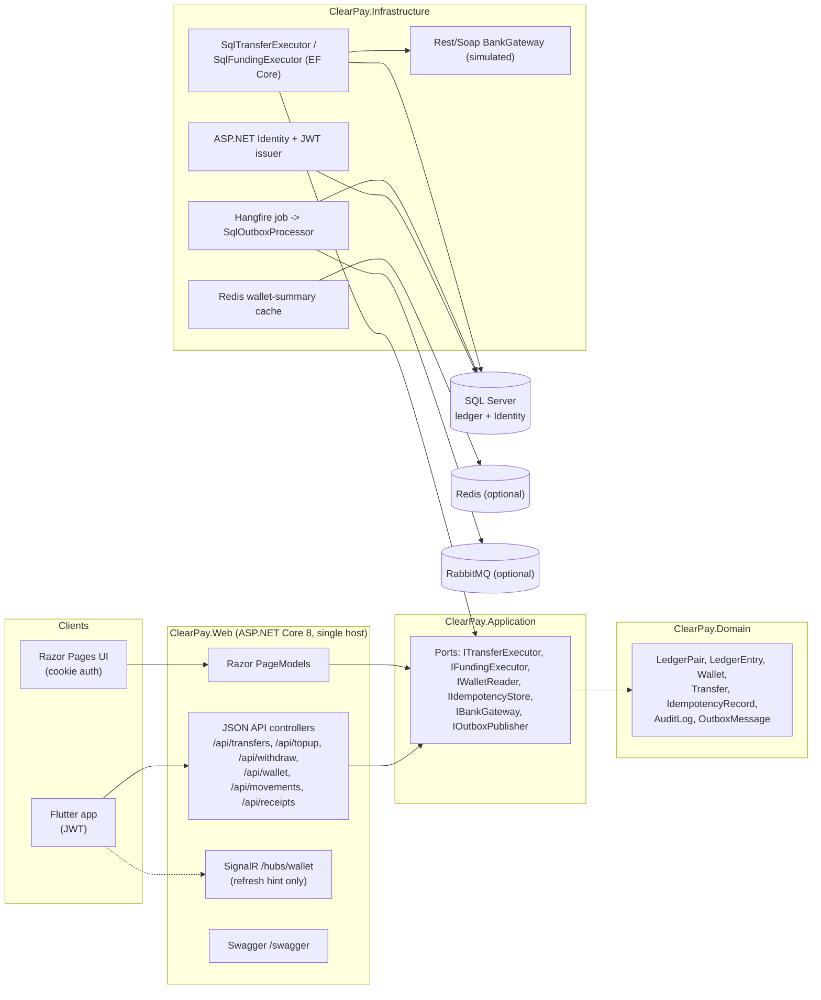
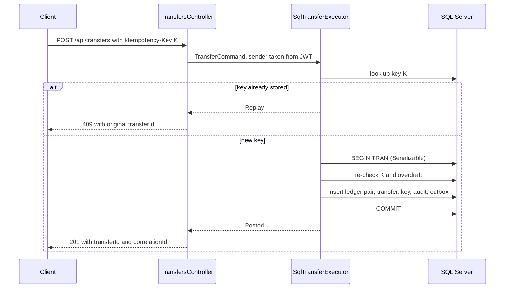

<div align="center">

# ClearPay Ledger

**A double-entry wallet backend with idempotent money APIs, a Razor web UI and a Flutter client.**
<br/>
<sub>İdempotent para API'leri, Razor web arayüzü ve Flutter istemcisi olan çift taraflı kayıt (double-entry) tabanlı cüzdan backend'i.</sub>

<br/>


[](https://github.com/HalilMertDeveli/clearpay-ledger/actions/workflows/ci.yml)
[](LICENSE)


<p><a href="#english">English</a> · <a href="#turkce">Türkçe</a></p>

</div>

> [!WARNING]
> **Portfolio demo, not a banking product.** ClearPay is not a licensed bank, payment institution or e-money issuer. No real money moves: the bank gateway is a simulated REST/SOAP stub and amounts are demo Turkish lira (TRY).
> <br/>**Portföy demosudur, bankacılık ürünü değildir.** ClearPay lisanslı bir banka, ödeme kuruluşu veya elektronik para kuruluşu değildir. Gerçek para hareketi yoktur: banka gateway'i simüle edilmiş bir REST/SOAP stub'ıdır ve tutarlar demo Türk lirasıdır (TRY).

| | |
|---|---|
| **Type · Tür** | Wallet API + Razor web UI + Flutter client · Cüzdan API'si + Razor web arayüzü + Flutter istemcisi |
| **Status · Durum** | Prototype / portfolio demo, runs locally · Prototip / portföy demosu, yerelde çalışır |
| **Stack · Teknoloji** | .NET 8, ASP.NET Core (Razor Pages + Web API), EF Core 8, SQL Server 2022, Identity + JWT, Hangfire, Redis, RabbitMQ, SignalR, Flutter |
| **Core ideas · Temel fikirler** | Double-entry ledger, derived balances, `Idempotency-Key`, single-transaction posting, transactional outbox |
| **Tests · Testler** | xUnit + `WebApplicationFactory` (SQLite and SQL Server), Flutter widget tests, GitHub Actions |
| **UI languages · Arayüz dilleri** | Turkish (default), English, German, French · Türkçe (varsayılan), İngilizce, Almanca, Fransızca |

---

<a id="english"></a>

## English

- [Problem & Solution](#en-problem)
- [Features](#en-features)
- [Architecture](#en-architecture)
- [Core Banking Concepts](#en-concepts)
- [Double-Entry Ledger](#en-ledger)
- [Idempotency](#en-idempotency)
- [Transaction Consistency](#en-consistency)
- [API Design](#en-api)
- [Technology Stack](#en-stack)
- [Repository Structure](#en-structure)
- [Tests & CI](#en-tests)
- [Installation](#en-install)
- [Demo Screenshots](#en-screenshots)
- [Security Considerations](#en-security)
- [Limitations](#en-limitations)
- [License](#en-license)

<a id="en-problem"></a>

### Problem & Solution

**Problem.** The classic wallet bug is `UPDATE Wallet SET Balance = Balance - @amount`. It loses history, cannot be audited, double-charges when a mobile client retries after a timeout, and leaves money half-moved when the process dies between the debit and the credit.

**Solution.** ClearPay never stores a balance. Every movement is a pair of signed ledger rows (one debit, one credit, summing to zero) written in **one SQL Server transaction** together with the transfer record, the idempotency key, an audit row and an outbox message. The balance is the sum of a wallet's ledger rows. A replayed request with the same `Idempotency-Key` returns **409 Conflict** and posts nothing.

<a id="en-features"></a>

### Features

| Area | Capability | Where |
|---|---|---|
| Ledger | Balanced debit/credit pairs, derived balance, no-overdraft check, refund pair (domain only) | `src/ClearPay.Domain/Ledger/LedgerPair.cs` |
| Transfers | Serializable transaction: ledger pair + transfer + idempotency key + audit + outbox | `src/ClearPay.Infrastructure/Persistence/SqlTransferExecutor.cs` |
| Top-up / withdraw | Pairs against a treasury (clearing) wallet via the simulated bank gateway | `SqlFundingExecutor.cs`, `src/ClearPay.Infrastructure/Banking/` |
| Idempotency | `Idempotency-Key` header, primary-key uniqueness, SHA-256 request fingerprint | `SqlIdempotencyStore.cs`, `src/ClearPay.Web/Controllers/TransfersController.cs` |
| Outbox | Hangfire job publishes committed outbox rows to RabbitMQ or the log | `src/ClearPay.Infrastructure/Jobs/OutboxHangfireJob.cs`, `SqlOutboxProcessor.cs`, `src/ClearPay.Infrastructure/Messaging/` |
| Receipts | JSON and generated PDF receipts by correlation id | `ReceiptsController.cs`, `src/ClearPay.Infrastructure/Documents/SimplePdfReceiptRenderer.cs` |
| Auth | ASP.NET Identity (cookie for Razor), JWT for API/mobile, optional Google/Apple/Firebase | `src/ClearPay.Infrastructure/Identity/` |
| Admin | Freeze/unfreeze wallets, outbox view and re-queue, audit search | `AdminApiController.cs`, `SqlAdminPanel.cs`, `Pages/Admin.cshtml` |
| Linked cards | Stores last four digits, scheme and label only | `CardsController.cs`, `src/ClearPay.Application/Funding/CardBindingParser.cs` |
| Realtime | SignalR `/hubs/wallet` sends refresh hints, never balances | `src/ClearPay.Web/Realtime/` |
| Caching | Optional Redis wallet-summary cache, invalidated after commit | `src/ClearPay.Infrastructure/Caching/` |
| Web UI | Razor Pages: overview, transfer, cards, top-up/withdraw, movements, receipt, admin | `src/ClearPay.Web/Pages/` |
| Localization | `tr` (default), `en`, `de`, `fr` resources | `src/ClearPay.Web/Localization/`, `src/ClearPay.Web/Resources/Localization/` |
| Mobile | Flutter JWT client with QR, PDF receipt sharing, SignalR refresh | `mobile/clearpay/lib/` |

<a id="en-architecture"></a>

### Architecture

Four projects in a dependency-inverted (onion / clean) layout. The rules are enforced by `ArchitectureTests` (for example: Domain has no package references, Web pages never compute ledger math or instantiate gateways).



<sub>Project layout and runtime dependencies, taken from the project references and `Program.cs`.</sub>

| Project | Holds | Must not hold |
|---------|-------|---------------|
| `ClearPay.Domain` | Ledger types and money rules (`LedgerPair.Create`, `EnsureBalanced`, `NetOf`, `WouldGoNegative`) | EF, HTTP, packages |
| `ClearPay.Application` | Use-case contracts (ports), commands/outcomes, FluentValidation | Connection strings, EF |
| `ClearPay.Infrastructure` | EF Core (SQL Server, SQLite for tests), Identity, JWT, Redis, RabbitMQ, Hangfire, gateways | Razor, CSS |
| `ClearPay.Web` | Composition root, controllers, Razor Pages, SignalR hub | Ledger arithmetic |
| `mobile/clearpay` | Flutter client (JWT); no local balance | Any money logic |

Redis and RabbitMQ are optional: without Redis the summary is read from SQL; without RabbitMQ the outbox publisher logs instead of publishing. SQL Server is the only source of truth.

<a id="en-concepts"></a>

### Core Banking Concepts Demonstrated

- **Double-entry bookkeeping**: every movement is one debit (`-amount`) and one credit (`+amount`) sharing a `PairId` and `CorrelationId`.
- **Derived balances**: no `Balance` column exists on `Wallet`; balance = sum of the wallet's signed entries.
- **No overdraft**: a debit is rejected if the ledger net would go below zero (checked inside the transaction).
- **Idempotency**: `Idempotency-Key` header, unique index, request fingerprint, 409 on replay.
- **Atomic posting**: ledger pair + transfer + idempotency key + audit + outbox commit or roll back together.
- **Transactional outbox**: integration events are rows in the same transaction; a background job publishes them later.
- **Audit trail**: who, what, when and correlation id for every posting.
- **Account freeze**: frozen wallets cannot send or withdraw (403); incoming credits still post.
- **Clearing account**: top-ups and withdrawals are pairs against a treasury wallet, so even external money keeps the ledger balanced.
- **Gateway timeout handling**: a timed-out top-up posts no ledger rows, records a pending outbox row and is answered with 202; retrying with the same key does not double-credit.
- **Reversal model**: `LedgerPair.CreateRefund` builds a reverse pair instead of editing history (domain-level; there is no refund endpoint yet).
- **Receipts**: every posting is retrievable by correlation id as JSON or a generated PDF.

<a id="en-ledger"></a>

### Double-Entry Ledger

```text
Transfer of 25.00 from A to B, correlation C, pair P

LedgerEntry  WalletId  Amount   PairId  CorrelationId  Kind
-----------  --------  -------  ------  -------------  --------
#1           A         -25.00   P       C              Transfer
#2           B         +25.00   P       C              Transfer
                       ------
                         0.00   (every pair, and therefore the whole ledger, sums to zero)
```

- `LedgerPair.Create` is the only constructor of entries used by the executors. It rejects non-positive amounts and identical wallets and calls `EnsureBalanced` on the result.
- The database adds its own guard: `CK_LedgerEntry_Amount_NotZero`, `decimal(18,2)` amounts, restrict-delete foreign keys, and an index on `(WalletId, CreatedAt)`.
- Balance = `SUM(Amount) WHERE WalletId = @wallet`. Wallet summaries may be cached in Redis but are invalidated after every commit and never written back to SQL.

Why no balance column? A stored balance is a second source of truth that can drift from the entries. Deriving it makes "balance equals the sum of entries" true by construction; the cost is a read over the wallet's rows, acceptable at demo scale (see [Limitations](#en-limitations)).

<a id="en-idempotency"></a>

### Idempotency

`POST /api/transfers` requires an `Idempotency-Key` header (max 128 characters).

1. Before opening a transaction, look up the key. Found: return **409** with the original `transferId` and `correlationId`; nothing is written.
2. Inside the transaction, look up the key again, then insert the key together with the ledger pair. The key is the primary key of `IdempotencyRecord`, so two racing requests cannot both commit: the loser gets a unique violation and is answered with 409.
3. The record stores a SHA-256 fingerprint of recipient, amount and description. Reusing a key with a different body is reported as `KeyPayloadMismatch` (also 409) and never debits.

Why 409 and not "200 with the cached response"? Both are defensible. 409 makes the replay explicit to the client ("already processed, not charged again") and still returns the original ids, so a client can open the existing receipt. Top-up and withdrawal follow the same rules with their own key scope.



<sub>Transfer request flow with an idempotency key, following `SqlTransferExecutor`.</sub>

<a id="en-consistency"></a>

### Transaction Consistency

- Transfers and fundings run in a single EF Core transaction at **Serializable** isolation. The overdraft check reads the sender's entries inside that transaction, so two concurrent debits cannot both see the old balance.
- Under contention SQL Server may pick a deadlock victim. That surfaces as **503 "nothing was charged, try again"**; the client retries with the same key and either succeeds or gets 409.
- Any failure before commit rolls back the ledger pair, transfer row, idempotency key, audit row and outbox row together, so a failed attempt does not burn the key.
- External side effects never happen inside the transaction. Cache invalidation and SignalR notifications run after commit; RabbitMQ publishing happens later from the outbox. For top-ups, the simulated bank call happens **before** the ledger transaction and only a successful response is posted.
- The outbox worker (Hangfire, every minute; enabled in `appsettings.Development.json` and `appsettings.Production.json`) marks rows `Sent` or `Failed`; failed rows can be re-queued from the admin API. Delivery is at-least-once, so consumers should deduplicate by correlation id.

<a id="en-api"></a>

### API Design

JSON API, JWT bearer auth, OpenAPI document at `/swagger`. Errors use RFC 7807 `application/problem+json`.

| Method | Path | Notes |
|--------|------|-------|
| POST | `/api/register` | Creates a customer, returns a JWT (201) |
| POST | `/api/token` | Email + password -> JWT (8 h) |
| POST | `/api/token/firebase` | Exchanges a Firebase ID token for a JWT (only if Firebase is configured) |
| POST | `/api/password/forgot`, `/api/password/reset` | Password recovery (the demo mailer writes to the log) |
| GET | `/api/wallet` | Balance (derived), month in/out, last movements |
| POST | `/api/transfers` | `Idempotency-Key` required. 201 / 400 / 401 / 403 frozen / 404 recipient / 409 replay / 422 insufficient funds / 503 retryable |
| GET | `/api/transfers/{id}` | Only the sender or recipient can read it; others get 404 |
| POST | `/api/topup`, `/api/withdraw` | `Idempotency-Key` required; 202 when the simulated gateway times out |
| GET | `/api/movements` | Paged (`page`, `pageSize` 1-50) |
| GET | `/api/receipts/{correlationId}` (`/pdf`) | Only parties to the movement |
| GET/POST | `/api/cards` | Linked cards store last 4 digits, scheme and label only (no PAN, no CVV) |
| GET/POST | `/api/admin/*` | `Admin` role: freeze/unfreeze, outbox, audit search |
| GET | `/api/health` | Liveness plus Redis/RabbitMQ status |

Design decisions:

- **The debited wallet is never a request field.** The sender is always the `NameIdentifier` claim of the JWT; extra body fields such as `fromUserId` are ignored (covered by tests).
- **Strangers get 404, not 403**, so transfer and receipt ids cannot be probed.
- **Status codes carry meaning a client can act on**: 409 = already done, 422 = business rule, 503 = safe to retry with the same key.
- **Two auth schemes, one user store**: cookie auth for Razor (with antiforgery), JWT for the API and mobile; the money API never accepts the browser cookie.

<a id="en-stack"></a>

### Technology Stack

| Area | Choice |
|------|--------|
| Runtime | .NET 8 (`net8.0`), ASP.NET Core Razor Pages + Web API in one host |
| Data | SQL Server 2022 (EF Core 8 migrations); SQLite for fast integration tests |
| Identity | ASP.NET Core Identity, JWT bearer, optional Google/Apple/Firebase sign-in |
| Validation | FluentValidation 11 |
| Background jobs | Hangfire 1.8 (outbox processing) |
| Cache / messaging | Redis (StackExchange.Redis), RabbitMQ (RabbitMQ.Client 6), both optional |
| Realtime | SignalR (refresh hints only, never balances) |
| Docs | Swashbuckle / OpenAPI |
| Mobile | Flutter (Dart `^3.11`), `http`, `flutter_secure_storage`, `signalr_netcore`, Firebase Auth (optional) |
| Tests | xUnit, FluentAssertions, `WebApplicationFactory`, Flutter widget tests |
| CI | GitHub Actions with a SQL Server service container |

<a id="en-structure"></a>

### Repository Structure

```text
clearpay-ledger/
├── src/
│   ├── ClearPay.Domain/          # Ledger entities and money rules, no packages
│   ├── ClearPay.Application/     # Ports, commands/outcomes, validators
│   ├── ClearPay.Infrastructure/  # EF Core, migrations, Identity/JWT, gateways, outbox, cache
│   └── ClearPay.Web/             # Program.cs, API controllers, Razor Pages, SignalR hub
├── tests/ClearPay.Tests/         # xUnit unit, integration, architecture and SQL Server tests
├── mobile/clearpay/              # Flutter client (JWT), see its own README
├── docs/assets/                  # README screenshots
├── docker-compose.yml            # Local SQL Server, Redis, RabbitMQ
├── .env.example                  # Placeholder values for docker compose
└── .github/workflows/ci.yml      # .NET + Flutter CI
```

<a id="en-tests"></a>

### Tests & CI

#### Results (measured locally by the author, 2026-11-03)

| Suite | Command | Infrastructure | Result |
|-------|---------|----------------|--------|
| .NET, with SQL Server | `dotnet test tests/ClearPay.Tests/ClearPay.Tests.csproj -c Release` with `CLEARPAY_TEST_SQLSERVER` set | SQLite files (created by the tests) + SQL Server 2022 in Docker | **190 passed, 0 failed, 0 skipped** |
| .NET, without SQL Server | same command, variable unset | SQLite only | 185 passed, 0 failed, 5 skipped (the SQL Server tests) |
| Flutter | `flutter analyze` and `flutter test` in `mobile/clearpay` | none (mocked HTTP) | no analyzer issues; **20 passed, 0 failed** |
| NuGet vulnerabilities | `dotnet list <project> package --vulnerable --include-transitive` | none | no vulnerable packages |

Counts are test cases as reported by the runners (xUnit theories count once per data row). The latest CI run on `main` (2026-11-03) passed both jobs.

What the money tests cover:

| Concern | Where |
|---------|-------|
| Debits = credits, balance derived from entries, every pair sums to zero | `LedgerPairTests`, `LedgerInvariantTests`, `LedgerSafetyApiTests.Ledger_stays_balanced...` |
| Idempotent replay returns 409 and posts nothing; same key with a different body | `TransferExecutorTests`, `TransferApiTests`, `LedgerSafetyApiTests.Errors_are_problem_details...` |
| Concurrent duplicate requests (same key, 8 in parallel) post exactly one transfer | `SqlServerLedgerTests` (SQL Server) |
| Concurrent different-key debits never overdraw the wallet | `SqlServerLedgerTests` (SQL Server) |
| Rollback when the database fails after rows were sent; key stays usable | `TransferRollbackTests` (SQLite), `SqlServerLedgerTests` (SQL Server) |
| Insufficient funds, frozen wallet, self transfer, unknown recipient | `TransferExecutorTests`, `TransferApiTests`, `LedgerSafetyApiTests` |
| Authentication: missing, forged and expired JWTs | `TransferApiTests`, `LedgerSafetyApiTests` |
| Authorization: body cannot choose the debited wallet; strangers cannot read transfers or receipts | `LedgerSafetyApiTests`, `TransferApiTests` |
| Validation: amount <= 0 or > 2 decimals, malformed JSON, oversized key/description | `LedgerSafetyApiTests`, `SqlServerLedgerTests` |
| Audit row and pending outbox row share the ledger correlation id; none on rejection | `LedgerSafetyApiTests` |
| Outbox worker, gateway timeout keeps the outbox row | `OutboxProcessorTests`, `FundingExecutorTests` |
| Database CHECK constraint rejects zero-amount rows | `SqlServerLedgerTests` |
| Architecture rules between layers | `ArchitectureTests` |

#### Run the tests

```bash
# Fast suite: SQLite only, no Docker needed (SQL Server tests are reported as skipped)
dotnet test tests/ClearPay.Tests/ClearPay.Tests.csproj -c Release

# Full suite: start a throw-away SQL Server and point the tests at it
docker run -d --name clearpay-test-sql -e ACCEPT_EULA=Y -e "MSSQL_SA_PASSWORD=<local-password>" \
  -p 127.0.0.1:14339:1433 mcr.microsoft.com/mssql/server:2022-latest
export CLEARPAY_TEST_SQLSERVER="Server=127.0.0.1,14339;User Id=sa;Password=<local-password>;TrustServerCertificate=True;Encrypt=True"
dotnet test tests/ClearPay.Tests/ClearPay.Tests.csproj -c Release

# Flutter
cd mobile/clearpay
cp firebase_options.template.dart lib/firebase_options.dart
flutter pub get && flutter analyze && flutter test
```

Each SQL Server test class creates its own database (`ClearPayTest_<random>`), applies the real EF migrations and drops it afterwards.

#### CI

`.github/workflows/ci.yml` runs on pushes to `main` and on pull requests:

1. **.NET job** with a `mcr.microsoft.com/mssql/server:2022-latest` service container: restore, build (Release), test with `CLEARPAY_TEST_SQLSERVER` set (so the concurrency and rollback tests run against SQL Server), upload TRX results, then fail the job if `dotnet list package --vulnerable --include-transitive` reports anything.
2. **Flutter job**: copy the Firebase options template, `flutter pub get`, `flutter analyze`, `flutter test`.

<a id="en-install"></a>

### Installation

Prerequisites: .NET SDK 8 or newer, Docker (or SQL Server LocalDB on Windows), Flutter for the mobile client.

```bash
# 1. Infrastructure (SQL Server, Redis, RabbitMQ)
cp .env.example .env            # set MSSQL_SA_PASSWORD to your own local value
docker compose up -d

# 2. Local secrets (never committed)
dotnet user-secrets set "ConnectionStrings:ClearPay" \
  "Server=localhost,1433;Database=ClearPay;User Id=sa;Password=<your MSSQL_SA_PASSWORD>;TrustServerCertificate=True;Encrypt=True" \
  --project src/ClearPay.Web
dotnet user-secrets set "Jwt:SigningKey" "<at least 32 random characters>" --project src/ClearPay.Web
dotnet user-secrets set "Seed:AdminPassword" "<password for the local admin account>" --project src/ClearPay.Web   # optional

# 3. Run (migrations are applied on startup)
dotnet run --project src/ClearPay.Web --launch-profile http
# Web UI: http://localhost:5153   Swagger: http://localhost:5153/swagger
```

Notes:

- In `Development`, `appsettings.Development.json` points at SQL Server LocalDB (`(localdb)\MSSQLLocalDB`); on Windows you can skip Docker and the connection-string secret.
- If `Jwt:SigningKey` is not set, Development falls back to a public placeholder key; every other environment refuses to start without a configured key.
- `Seed:AdminPassword` creates `admin@clearpay.test` with the `Admin` role in Development only. If it is not set, no admin account is created; register normally instead.
- Google, Apple and Firebase sign-in stay disabled until their settings are provided (`Authentication:Google:*`, `Authentication:Apple:*`, `Firebase:ProjectId`).
- Mobile client: see [`mobile/clearpay/README.md`](mobile/clearpay/README.md).

<a id="en-screenshots"></a>

### Demo Screenshots

| | |
|---|---|
|  |  |
| Wallet overview: balance derived from the ledger, last movements · Cüzdan özeti: defterden türetilen bakiye, son hareketler | Linked cards: only last four digits, scheme and label are stored; the number shown is the standard Visa test number · Kartlarım: yalnızca son dört hane, şema ve etiket saklanır; görünen numara standart Visa test numarasıdır |

Both screenshots show the local Development seed account on a `.test` domain with the Turkish UI; no real personal data.

<a id="en-security"></a>

### Security Considerations

- **No real secrets in the repository.** Connection strings, JWT signing key, OAuth and Firebase settings come from user-secrets or environment variables. `appsettings*.json` and `.env.example` contain empty values or local-only placeholders; the CI workflow uses a throw-away password for its ephemeral container. Firebase client files are generated locally by `flutterfire configure` and are gitignored.
- **Authorization by construction.** The debited wallet comes from the token, not the request body. Transfers and receipts are scoped to their parties (404 for others). Admin endpoints require the `Admin` role.
- **JWT**: HMAC-SHA256, issuer, audience, signature and lifetime validated (1 minute clock skew); 8-hour tokens without refresh tokens or server-side revocation.
- **Card data**: only last four digits, scheme and a label are stored; PAN and CVV are never persisted.
- **Data integrity** relies on database constraints as well as code: unique idempotency key, non-zero amount CHECK constraint, restrict-delete foreign keys.
- **Known gaps** for anything beyond a demo: no login lockout or rate limiting, Swagger is exposed in all environments, forwarded headers are trusted from any proxy, SignalR passes the JWT in the query string (standard for WebSockets, but it can appear in proxy logs), and there is no 2FA, KYC or AML.

<a id="en-limitations"></a>

### Limitations

- Portfolio demo. Not a licensed financial product; not audited; no real bank or card network integration (the gateway is simulated).
- Single currency (TRY), no FX, fees, interest, statements, limits or scheduled payments.
- Balance is computed by summing all of a wallet's entries on each check. A production ledger would add balance snapshots or a locked running balance per account.
- Serializable isolation keeps the overdraft check correct but converts contention into deadlock retries (503). Row-level locking of the sender's account would scale better.
- Concurrent duplicate top-up requests can both reach the simulated gateway before one of them wins the idempotency insert; the ledger still posts once. A real integration would reserve the key first and pass it to the provider as its idempotency key.
- The outbox worker is a single Hangfire job with at-least-once delivery; it is not designed for multiple competing workers.
- Refunds exist as a domain operation (`LedgerPair.CreateRefund`) but have no API or UI.
- Password-reset mail is only written to the log (`LogAccountMailer`); there is no real email delivery.
- The fast test suite uses SQLite; SQL Server-specific behaviour (isolation, deadlocks, constraints) is covered only by the SQL Server tests.
- Not deployed; runs locally.

<a id="en-license"></a>

### License

[MIT](LICENSE) (c) 2026 Halil Mert Develi.

Third-party components keep their own licences: vendored `anime.js` 3.2.2 (MIT) and the `@microsoft/signalr` browser client (MIT) under `src/ClearPay.Web/wwwroot/js/vendor`; the Inter font is loaded from Google Fonts (SIL Open Font License). NuGet and pub dependencies are restored from their registries and are MIT, Apache-2.0 or BSD licensed, except Hangfire (LGPL-3.0, used unmodified as a library).

<p align="right"><a href="#english">Back to top</a> · <a href="#turkce">Türkçe</a></p>

---

<a id="turkce"></a>

## Türkçe

> **Portföy demosudur, bankacılık ürünü değildir.** ClearPay lisanslı bir banka, ödeme kuruluşu veya elektronik para kuruluşu değildir. Gerçek para hareketi yoktur: yükleme ve çekim için kullanılan banka gateway'i simüle edilmiş bir REST/SOAP stub'ıdır. Tutarlar demo Türk lirasıdır (TRY). Arayüz varsayılan olarak Türkçedir; İngilizce, Almanca ve Fransızca da mevcuttur.

- [Problem ve Çözüm](#tr-problem)
- [Özellikler](#tr-features)
- [Mimari](#tr-architecture)
- [Gösterilen Bankacılık Kavramları](#tr-concepts)
- [Çift Taraflı Defter](#tr-ledger)
- [Idempotency](#tr-idempotency)
- [Transaction Tutarlılığı](#tr-consistency)
- [API Tasarımı](#tr-api)
- [Teknoloji Yığını](#tr-stack)
- [Depo Yapısı](#tr-structure)
- [Testler ve CI](#tr-tests)
- [Kurulum](#tr-install)
- [Demo Ekran Görüntüleri](#tr-screenshots)
- [Güvenlik Notları](#tr-security)
- [Sınırlamalar](#tr-limitations)
- [Lisans](#tr-license)

<a id="tr-problem"></a>

### Problem ve Çözüm

**Problem.** Klasik cüzdan hatası `UPDATE Wallet SET Balance = Balance - @amount` ifadesidir. Geçmişi kaybeder, denetlenemez, mobil istemci zaman aşımından sonra isteği tekrarladığında iki kez para çeker ve süreç borç ile alacak arasında çökerse parayı yarı yolda bırakır.

**Çözüm.** ClearPay bakiyeyi hiçbir zaman saklamaz. Her hareket, işaretli iki defter satırından (bir borç, bir alacak; toplamları sıfır) oluşan bir çifttir ve transfer kaydı, idempotency anahtarı, denetim (audit) satırı ve outbox mesajıyla birlikte **tek bir SQL Server transaction'ı** içinde yazılır. Bakiye, cüzdanın defter satırlarının toplamıdır. Aynı `Idempotency-Key` ile tekrarlanan istek **409 Conflict** döner ve hiçbir kayıt oluşturmaz.

<a id="tr-features"></a>

### Özellikler

| Alan | Yetenek | Konum |
|---|---|---|
| Defter | Dengeli borç/alacak çiftleri, türetilmiş bakiye, eksi bakiye kontrolü, iade çifti (yalnızca domain) | `src/ClearPay.Domain/Ledger/LedgerPair.cs` |
| Transferler | Serializable transaction: defter çifti + transfer + idempotency anahtarı + audit + outbox | `src/ClearPay.Infrastructure/Persistence/SqlTransferExecutor.cs` |
| Yükleme / çekim | Simüle banka gateway'i üzerinden hazine (takas) cüzdanına karşı çiftler | `SqlFundingExecutor.cs`, `src/ClearPay.Infrastructure/Banking/` |
| Idempotency | `Idempotency-Key` header'ı, primary key benzersizliği, SHA-256 istek parmak izi | `SqlIdempotencyStore.cs`, `src/ClearPay.Web/Controllers/TransfersController.cs` |
| Outbox | Hangfire job'ı commit edilmiş outbox satırlarını RabbitMQ'ya veya log'a yayınlar | `src/ClearPay.Infrastructure/Jobs/OutboxHangfireJob.cs`, `SqlOutboxProcessor.cs`, `src/ClearPay.Infrastructure/Messaging/` |
| Dekontlar | Correlation id ile JSON ve üretilen PDF dekont | `ReceiptsController.cs`, `src/ClearPay.Infrastructure/Documents/SimplePdfReceiptRenderer.cs` |
| Kimlik doğrulama | ASP.NET Identity (Razor için cookie), API/mobil için JWT, isteğe bağlı Google/Apple/Firebase | `src/ClearPay.Infrastructure/Identity/` |
| Yönetim | Cüzdan dondurma/çözme, outbox görüntüleme ve yeniden kuyruğa alma, audit arama | `AdminApiController.cs`, `SqlAdminPanel.cs`, `Pages/Admin.cshtml` |
| Bağlı kartlar | Yalnızca son dört hane, şema ve etiket saklanır | `CardsController.cs`, `src/ClearPay.Application/Funding/CardBindingParser.cs` |
| Gerçek zamanlı | SignalR `/hubs/wallet` yalnızca yenileme sinyali gönderir, bakiye göndermez | `src/ClearPay.Web/Realtime/` |
| Önbellek | İsteğe bağlı Redis cüzdan özeti önbelleği, commit sonrası geçersiz kılınır | `src/ClearPay.Infrastructure/Caching/` |
| Web arayüzü | Razor Pages: özet, havale, kartlar, yükle/çek, hareketler, dekont, yönetim | `src/ClearPay.Web/Pages/` |
| Yerelleştirme | `tr` (varsayılan), `en`, `de`, `fr` kaynakları | `src/ClearPay.Web/Localization/`, `src/ClearPay.Web/Resources/Localization/` |
| Mobil | QR, PDF dekont paylaşımı ve SignalR yenilemesi olan Flutter JWT istemcisi | `mobile/clearpay/lib/` |

<a id="tr-architecture"></a>

### Mimari

Bağımlılıkları tersine çevrilmiş (onion / clean) bir yapıda dört proje bulunur. Kurallar `ArchitectureTests` ile zorunlu kılınır (örneğin Domain hiçbir pakete referans vermez; Web sayfaları defter hesabı yapmaz ve gateway örneği oluşturmaz).


<sub>Proje referanslarından ve `Program.cs` dosyasından çıkarılan proje düzeni ve çalışma zamanı bağımlılıkları.</sub>

| Proje | İçerir | İçeremez |
|---------|-------|---------------|
| `ClearPay.Domain` | Defter tipleri ve para kuralları (`LedgerPair.Create`, `EnsureBalanced`, `NetOf`, `WouldGoNegative`) | EF, HTTP, paketler |
| `ClearPay.Application` | Use-case sözleşmeleri (port'lar), komutlar/sonuçlar, FluentValidation | Connection string, EF |
| `ClearPay.Infrastructure` | EF Core (SQL Server, testler için SQLite), Identity, JWT, Redis, RabbitMQ, Hangfire, gateway'ler | Razor, CSS |
| `ClearPay.Web` | Composition root, controller'lar, Razor Pages, SignalR hub | Defter aritmetiği |
| `mobile/clearpay` | Flutter istemcisi (JWT); yerel bakiye tutmaz | Herhangi bir para mantığı |

Redis ve RabbitMQ isteğe bağlıdır: Redis yoksa özet SQL'den okunur; RabbitMQ yoksa outbox publisher yayınlamak yerine log'a yazar. Tek doğruluk kaynağı SQL Server'dır.

<a id="tr-concepts"></a>

### Gösterilen Bankacılık Kavramları

- **Çift taraflı kayıt**: her hareket, aynı `PairId` ve `CorrelationId` değerini paylaşan bir borç (`-tutar`) ve bir alacaktan (`+tutar`) oluşur.
- **Türetilmiş bakiye**: `Wallet` üzerinde `Balance` sütunu yoktur; bakiye, cüzdanın işaretli kayıtlarının toplamıdır.
- **Eksi bakiye yok**: defter neti sıfırın altına düşecekse borç reddedilir (kontrol transaction içinde yapılır).
- **Idempotency**: `Idempotency-Key` header'ı, benzersiz index, istek parmak izi, tekrarda 409.
- **Atomik kayıt**: defter çifti + transfer + idempotency anahtarı + audit + outbox birlikte commit edilir veya birlikte geri alınır.
- **Transactional outbox**: entegrasyon olayları aynı transaction içinde satır olarak yazılır; bir arka plan job'ı bunları daha sonra yayınlar.
- **Denetim izi**: her kayıt için kim, ne, ne zaman ve correlation id tutulur.
- **Hesap dondurma**: dondurulmuş cüzdanlar para gönderemez veya çekemez (403); gelen alacaklar yine de kaydedilir.
- **Takas hesabı**: yükleme ve çekimler bir hazine cüzdanına karşı çift olarak yazılır; böylece dışarıdan gelen para da defteri dengede tutar.
- **Gateway zaman aşımı**: zaman aşımına uğrayan yükleme defter satırı oluşturmaz, bekleyen bir outbox satırı yazar ve 202 ile yanıtlanır; aynı anahtarla tekrar denemek çift alacak oluşturmaz.
- **Ters kayıt modeli**: `LedgerPair.CreateRefund` geçmişi düzenlemek yerine ters bir çift üretir (domain seviyesinde; henüz iade endpoint'i yoktur).
- **Dekontlar**: her kayıt correlation id ile JSON veya üretilen PDF olarak alınabilir.

<a id="tr-ledger"></a>

### Çift Taraflı Defter

```text
Transfer of 25.00 from A to B, correlation C, pair P

LedgerEntry  WalletId  Amount   PairId  CorrelationId  Kind
-----------  --------  -------  ------  -------------  --------
#1           A         -25.00   P       C              Transfer
#2           B         +25.00   P       C              Transfer
                       ------
                         0.00   (every pair, and therefore the whole ledger, sums to zero)
```

- `LedgerPair.Create`, executor'ların kullandığı tek kayıt oluşturucusudur. Pozitif olmayan tutarları ve aynı cüzdanlar arası işlemi reddeder, sonuç üzerinde `EnsureBalanced` çağırır.
- Veritabanı kendi korumasını ekler: `CK_LedgerEntry_Amount_NotZero`, `decimal(18,2)` tutarlar, silmeyi kısıtlayan (restrict) foreign key'ler ve `(WalletId, CreatedAt)` üzerinde bir index.
- Bakiye = `SUM(Amount) WHERE WalletId = @wallet`. Cüzdan özetleri Redis'te önbelleğe alınabilir; ancak her commit sonrasında geçersiz kılınır ve hiçbir zaman SQL'e geri yazılmaz.

Neden bakiye sütunu yok? Saklanan bakiye, kayıtlardan sapabilecek ikinci bir doğruluk kaynağıdır. Bakiyeyi türetmek "bakiye, kayıtların toplamıdır" kuralını yapısal olarak garanti eder; bedeli cüzdan satırları üzerinde bir okumadır ve demo ölçeğinde kabul edilebilirdir (bkz. [Sınırlamalar](#tr-limitations)).

<a id="tr-idempotency"></a>

### Idempotency

`POST /api/transfers` bir `Idempotency-Key` header'ı gerektirir (en fazla 128 karakter).

1. Transaction açılmadan önce anahtar aranır. Bulunursa orijinal `transferId` ve `correlationId` ile **409** döner; hiçbir şey yazılmaz.
2. Transaction içinde anahtar tekrar aranır, ardından defter çiftiyle birlikte eklenir. Anahtar `IdempotencyRecord` tablosunun primary key'idir; bu nedenle yarışan iki istek birden commit edemez: kaybeden taraf unique violation alır ve 409 ile yanıtlanır.
3. Kayıt; alıcı, tutar ve açıklamanın SHA-256 parmak izini saklar. Aynı anahtarın farklı bir gövdeyle kullanılması `KeyPayloadMismatch` (yine 409) olarak bildirilir ve asla borç oluşturmaz.

Neden "önbellekteki yanıtla 200" yerine 409? İkisi de savunulabilir. 409, tekrarı istemciye açıkça bildirir ("zaten işlendi, tekrar ücret alınmadı") ve orijinal id'leri yine döndürür; böylece istemci mevcut dekontu açabilir. Yükleme ve çekim de kendi anahtar kapsamlarıyla aynı kuralları izler.


<sub>`SqlTransferExecutor` akışına göre idempotency anahtarlı transfer isteği.</sub>

<a id="tr-consistency"></a>

### Transaction Tutarlılığı

- Transfer ve yükleme/çekim işlemleri **Serializable** izolasyon seviyesinde tek bir EF Core transaction'ında çalışır. Eksi bakiye kontrolü gönderenin kayıtlarını bu transaction içinde okur; bu yüzden eşzamanlı iki borç eski bakiyeyi birlikte göremez.
- Çekişme altında SQL Server bir deadlock kurbanı seçebilir. Bu durum **503 "hiçbir ücret alınmadı, tekrar deneyin"** olarak döner; istemci aynı anahtarla tekrar dener ve ya başarılı olur ya da 409 alır.
- Commit öncesindeki her hata defter çiftini, transfer satırını, idempotency anahtarını, audit satırını ve outbox satırını birlikte geri alır; bu nedenle başarısız deneme anahtarı tüketmez.
- Dış yan etkiler asla transaction içinde gerçekleşmez. Önbellek geçersiz kılma ve SignalR bildirimleri commit sonrasında çalışır; RabbitMQ yayını daha sonra outbox üzerinden yapılır. Yüklemelerde simüle banka çağrısı defter transaction'ından **önce** yapılır ve yalnızca başarılı yanıt kaydedilir.
- Outbox worker'ı (Hangfire, dakikada bir; `appsettings.Development.json` ve `appsettings.Production.json` içinde etkin) satırları `Sent` veya `Failed` olarak işaretler; başarısız satırlar admin API'sinden yeniden kuyruğa alınabilir. Teslimat en az bir kez (at-least-once) garantilidir; tüketiciler correlation id ile tekilleştirme yapmalıdır.

<a id="tr-api"></a>

### API Tasarımı

JSON API, JWT bearer kimlik doğrulaması, `/swagger` adresinde OpenAPI dokümanı. Hatalar RFC 7807 `application/problem+json` formatındadır.

| Metot | Yol | Notlar |
|--------|------|-------|
| POST | `/api/register` | Müşteri oluşturur, JWT döner (201) |
| POST | `/api/token` | E-posta + şifre -> JWT (8 saat) |
| POST | `/api/token/firebase` | Firebase ID token'ını JWT ile değiştirir (yalnızca Firebase yapılandırılmışsa) |
| POST | `/api/password/forgot`, `/api/password/reset` | Şifre kurtarma (demo mailer log'a yazar) |
| GET | `/api/wallet` | Bakiye (türetilmiş), aylık giriş/çıkış, son hareketler |
| POST | `/api/transfers` | `Idempotency-Key` zorunlu. 201 / 400 / 401 / 403 dondurulmuş / 404 alıcı / 409 tekrar / 422 yetersiz bakiye / 503 tekrar denenebilir |
| GET | `/api/transfers/{id}` | Yalnızca gönderen veya alıcı okuyabilir; diğerleri 404 alır |
| POST | `/api/topup`, `/api/withdraw` | `Idempotency-Key` zorunlu; simüle gateway zaman aşımına uğrarsa 202 |
| GET | `/api/movements` | Sayfalı (`page`, `pageSize` 1-50) |
| GET | `/api/receipts/{correlationId}` (`/pdf`) | Yalnızca hareketin tarafları |
| GET/POST | `/api/cards` | Bağlı kartlarda yalnızca son 4 hane, şema ve etiket saklanır (PAN ve CVV yok) |
| GET/POST | `/api/admin/*` | `Admin` rolü: dondurma/çözme, outbox, audit arama |
| GET | `/api/health` | Canlılık ve Redis/RabbitMQ durumu |

Tasarım kararları:

- **Borçlandırılan cüzdan hiçbir zaman istek alanı değildir.** Gönderen her zaman JWT'deki `NameIdentifier` claim'idir; `fromUserId` gibi ek gövde alanları yok sayılır (testlerle doğrulanır).
- **Yabancılar 403 değil 404 alır**; böylece transfer ve dekont id'leri yoklanamaz.
- **Durum kodları istemcinin uygulayabileceği anlam taşır**: 409 = zaten yapıldı, 422 = iş kuralı, 503 = aynı anahtarla güvenle tekrar denenebilir.
- **İki kimlik doğrulama şeması, tek kullanıcı deposu**: Razor için cookie (antiforgery ile), API ve mobil için JWT; para API'si tarayıcı cookie'sini asla kabul etmez.

<a id="tr-stack"></a>

### Teknoloji Yığını

| Alan | Seçim |
|------|--------|
| Çalışma zamanı | .NET 8 (`net8.0`), tek host içinde ASP.NET Core Razor Pages + Web API |
| Veri | SQL Server 2022 (EF Core 8 migration'ları); hızlı entegrasyon testleri için SQLite |
| Kimlik | ASP.NET Core Identity, JWT bearer, isteğe bağlı Google/Apple/Firebase girişi |
| Doğrulama | FluentValidation 11 |
| Arka plan işleri | Hangfire 1.8 (outbox işleme) |
| Önbellek / mesajlaşma | Redis (StackExchange.Redis), RabbitMQ (RabbitMQ.Client 6), ikisi de isteğe bağlı |
| Gerçek zamanlı | SignalR (yalnızca yenileme sinyali, asla bakiye değil) |
| Dokümantasyon | Swashbuckle / OpenAPI |
| Mobil | Flutter (Dart `^3.11`), `http`, `flutter_secure_storage`, `signalr_netcore`, Firebase Auth (isteğe bağlı) |
| Testler | xUnit, FluentAssertions, `WebApplicationFactory`, Flutter widget testleri |
| CI | SQL Server service container'lı GitHub Actions |

<a id="tr-structure"></a>

### Depo Yapısı

```text
clearpay-ledger/
├── src/
│   ├── ClearPay.Domain/          # Defter varlıkları ve para kuralları, paket yok
│   ├── ClearPay.Application/     # Port'lar, komutlar/sonuçlar, validator'lar
│   ├── ClearPay.Infrastructure/  # EF Core, migration'lar, Identity/JWT, gateway'ler, outbox, önbellek
│   └── ClearPay.Web/             # Program.cs, API controller'ları, Razor Pages, SignalR hub
├── tests/ClearPay.Tests/         # xUnit birim, entegrasyon, mimari ve SQL Server testleri
├── mobile/clearpay/              # Flutter istemcisi (JWT), kendi README'si var
├── docs/assets/                  # README ekran görüntüleri
├── docker-compose.yml            # Yerel SQL Server, Redis, RabbitMQ
├── .env.example                  # docker compose için yer tutucu değerler
└── .github/workflows/ci.yml      # .NET + Flutter CI
```

<a id="tr-tests"></a>

### Testler ve CI

#### Sonuçlar (yazar tarafından yerelde ölçüldü, 2026-11-03)

| Paket | Komut | Altyapı | Sonuç |
|-------|---------|----------------|--------|
| .NET, SQL Server ile | `CLEARPAY_TEST_SQLSERVER` tanımlıyken `dotnet test tests/ClearPay.Tests/ClearPay.Tests.csproj -c Release` | SQLite dosyaları (testler oluşturur) + Docker'da SQL Server 2022 | **190 başarılı, 0 başarısız, 0 atlanan** |
| .NET, SQL Server olmadan | aynı komut, değişken tanımsız | yalnızca SQLite | 185 başarılı, 0 başarısız, 5 atlanan (SQL Server testleri) |
| Flutter | `mobile/clearpay` içinde `flutter analyze` ve `flutter test` | yok (mock HTTP) | analyzer uyarısı yok; **20 başarılı, 0 başarısız** |
| NuGet güvenlik açıkları | `dotnet list <project> package --vulnerable --include-transitive` | yok | güvenlik açığı olan paket yok |

Sayılar, test çalıştırıcılarının raporladığı test vakalarıdır (xUnit theory'leri her veri satırı için bir kez sayılır). `main` üzerindeki son CI çalışması (2026-11-03) iki job'ı da başarıyla geçti.

Para testlerinin kapsadıkları:

| Konu | Konum |
|---------|-------|
| Borç = alacak, bakiye kayıtlardan türetilir, her çiftin toplamı sıfırdır | `LedgerPairTests`, `LedgerInvariantTests`, `LedgerSafetyApiTests.Ledger_stays_balanced...` |
| Idempotent tekrar 409 döner ve kayıt oluşturmaz; aynı anahtar farklı gövdeyle | `TransferExecutorTests`, `TransferApiTests`, `LedgerSafetyApiTests.Errors_are_problem_details...` |
| Eşzamanlı tekrar istekler (aynı anahtar, 8 paralel) tam olarak bir transfer oluşturur | `SqlServerLedgerTests` (SQL Server) |
| Farklı anahtarlı eşzamanlı borçlar cüzdanı asla eksiye düşürmez | `SqlServerLedgerTests` (SQL Server) |
| Satırlar gönderildikten sonra veritabanı hata verirse rollback; anahtar kullanılabilir kalır | `TransferRollbackTests` (SQLite), `SqlServerLedgerTests` (SQL Server) |
| Yetersiz bakiye, dondurulmuş cüzdan, kendine transfer, bilinmeyen alıcı | `TransferExecutorTests`, `TransferApiTests`, `LedgerSafetyApiTests` |
| Kimlik doğrulama: eksik, sahte ve süresi dolmuş JWT | `TransferApiTests`, `LedgerSafetyApiTests` |
| Yetkilendirme: gövde borçlandırılacak cüzdanı seçemez; yabancılar transfer ve dekont okuyamaz | `LedgerSafetyApiTests`, `TransferApiTests` |
| Doğrulama: tutar <= 0 veya 2'den fazla ondalık, bozuk JSON, aşırı uzun anahtar/açıklama | `LedgerSafetyApiTests`, `SqlServerLedgerTests` |
| Audit satırı ve bekleyen outbox satırı defter correlation id'sini paylaşır; red durumunda yazılmaz | `LedgerSafetyApiTests` |
| Outbox worker'ı, gateway zaman aşımında outbox satırının korunması | `OutboxProcessorTests`, `FundingExecutorTests` |
| Veritabanı CHECK kısıtı sıfır tutarlı satırları reddeder | `SqlServerLedgerTests` |
| Katmanlar arası mimari kurallar | `ArchitectureTests` |

#### Testleri çalıştırma

```bash
# Hızlı paket: yalnızca SQLite, Docker gerekmez (SQL Server testleri atlanmış olarak raporlanır)
dotnet test tests/ClearPay.Tests/ClearPay.Tests.csproj -c Release

# Tam paket: geçici bir SQL Server başlatın ve testleri ona yönlendirin
docker run -d --name clearpay-test-sql -e ACCEPT_EULA=Y -e "MSSQL_SA_PASSWORD=<local-password>" \
  -p 127.0.0.1:14339:1433 mcr.microsoft.com/mssql/server:2022-latest
export CLEARPAY_TEST_SQLSERVER="Server=127.0.0.1,14339;User Id=sa;Password=<local-password>;TrustServerCertificate=True;Encrypt=True"
dotnet test tests/ClearPay.Tests/ClearPay.Tests.csproj -c Release

# Flutter
cd mobile/clearpay
cp firebase_options.template.dart lib/firebase_options.dart
flutter pub get && flutter analyze && flutter test
```

Her SQL Server test sınıfı kendi veritabanını (`ClearPayTest_<random>`) oluşturur, gerçek EF migration'larını uygular ve sonunda veritabanını siler.

#### CI

`.github/workflows/ci.yml`, `main` dalına yapılan push'larda ve pull request'lerde çalışır:

1. **.NET job'ı** (`mcr.microsoft.com/mssql/server:2022-latest` service container'ı ile): restore, build (Release), `CLEARPAY_TEST_SQLSERVER` tanımlıyken test (eşzamanlılık ve rollback testleri SQL Server'a karşı çalışır), TRX sonuçlarını yükleme; `dotnet list package --vulnerable --include-transitive` herhangi bir bulgu raporlarsa job başarısız olur.
2. **Flutter job'ı**: Firebase options şablonunu kopyalama, `flutter pub get`, `flutter analyze`, `flutter test`.

<a id="tr-install"></a>

### Kurulum

Gereksinimler: .NET SDK 8 veya üzeri, Docker (ya da Windows'ta SQL Server LocalDB), mobil istemci için Flutter.

```bash
# 1. Altyapı (SQL Server, Redis, RabbitMQ)
cp .env.example .env            # MSSQL_SA_PASSWORD değerini kendi yerel değerinizle değiştirin
docker compose up -d

# 2. Yerel gizli ayarlar (asla commit edilmez)
dotnet user-secrets set "ConnectionStrings:ClearPay" \
  "Server=localhost,1433;Database=ClearPay;User Id=sa;Password=<your MSSQL_SA_PASSWORD>;TrustServerCertificate=True;Encrypt=True" \
  --project src/ClearPay.Web
dotnet user-secrets set "Jwt:SigningKey" "<at least 32 random characters>" --project src/ClearPay.Web
dotnet user-secrets set "Seed:AdminPassword" "<password for the local admin account>" --project src/ClearPay.Web   # isteğe bağlı

# 3. Çalıştırma (migration'lar başlangıçta uygulanır)
dotnet run --project src/ClearPay.Web --launch-profile http
# Web arayüzü: http://localhost:5153   Swagger: http://localhost:5153/swagger
```

Notlar:

- `Development` ortamında `appsettings.Development.json` SQL Server LocalDB'yi (`(localdb)\MSSQLLocalDB`) kullanır; Windows'ta Docker'ı ve connection string secret'ını atlayabilirsiniz.
- `Jwt:SigningKey` tanımlı değilse Development herkese açık bir yer tutucu anahtara düşer; diğer tüm ortamlar anahtar yapılandırılmadan başlamayı reddeder.
- `Seed:AdminPassword` yalnızca Development ortamında `Admin` rolüne sahip `admin@clearpay.test` hesabını oluşturur. Tanımlı değilse admin hesabı oluşturulmaz; normal şekilde kayıt olun.
- Google, Apple ve Firebase girişi ayarları verilene kadar kapalı kalır (`Authentication:Google:*`, `Authentication:Apple:*`, `Firebase:ProjectId`).
- Mobil istemci: [`mobile/clearpay/README.md`](mobile/clearpay/README.md) dosyasına bakın.

<a id="tr-screenshots"></a>

### Demo Ekran Görüntüleri

| | |
|---|---|
|  |  |
| Cüzdan özeti: defterden türetilen bakiye, son hareketler · Wallet overview: balance derived from the ledger, last movements | Kartlarım: yalnızca son dört hane, şema ve etiket saklanır; görünen numara standart Visa test numarasıdır · Linked cards: only last four digits, scheme and label are stored |

İki ekran görüntüsü de Türkçe arayüzde, `.test` alan adındaki yerel Development seed hesabını gösterir; gerçek kişisel veri içermez.

<a id="tr-security"></a>

### Güvenlik Notları

- **Depoda gerçek gizli bilgi yoktur.** Connection string'ler, JWT imzalama anahtarı, OAuth ve Firebase ayarları user-secrets veya ortam değişkenlerinden gelir. `appsettings*.json` ve `.env.example` yalnızca boş değerler veya yerel kullanım için yer tutucular içerir; CI workflow'u geçici container'ı için tek kullanımlık bir şifre kullanır. Firebase istemci dosyaları `flutterfire configure` ile yerelde üretilir ve gitignore kapsamındadır.
- **Yapısal yetkilendirme.** Borçlandırılan cüzdan istek gövdesinden değil token'dan gelir. Transferler ve dekontlar taraflarıyla sınırlıdır (diğerleri için 404). Admin endpoint'leri `Admin` rolü gerektirir.
- **JWT**: HMAC-SHA256; issuer, audience, imza ve süre doğrulanır (1 dakika saat kayması toleransı); refresh token veya sunucu tarafı iptal olmadan 8 saatlik token'lar.
- **Kart verisi**: yalnızca son dört hane, şema ve etiket saklanır; PAN ve CVV hiçbir zaman kalıcı olarak tutulmaz.
- **Veri bütünlüğü** kodun yanı sıra veritabanı kısıtlarına da dayanır: benzersiz idempotency anahtarı, sıfır olmayan tutar CHECK kısıtı, silmeyi kısıtlayan foreign key'ler.
- **Demo ötesi için bilinen eksikler**: giriş kilitleme veya rate limiting yok, Swagger tüm ortamlarda açık, forwarded header'lara her proxy'den güveniliyor, SignalR JWT'yi query string'de taşıyor (WebSocket için standart, ancak proxy log'larında görünebilir); 2FA, KYC veya AML yok.

<a id="tr-limitations"></a>

### Sınırlamalar

- Portföy demosudur. Lisanslı bir finansal ürün değildir; denetlenmemiştir; gerçek banka veya kart ağı entegrasyonu yoktur (gateway simüle edilmiştir).
- Tek para birimi (TRY); kur çevrimi, ücret, faiz, hesap özeti, limit veya zamanlanmış ödeme yoktur.
- Bakiye, her kontrolde cüzdanın tüm kayıtları toplanarak hesaplanır. Üretim seviyesindeki bir defter, hesap başına bakiye snapshot'ları veya kilitli bir yürüyen bakiye ekler.
- Serializable izolasyon eksi bakiye kontrolünü doğru tutar, ancak çekişmeyi deadlock tekrarlarına (503) dönüştürür. Gönderen hesabın satır seviyesinde kilitlenmesi daha iyi ölçeklenir.
- Eşzamanlı tekrar yükleme istekleri, biri idempotency eklemesini kazanmadan önce simüle gateway'e ulaşabilir; defter yine yalnızca bir kez kayıt yapar. Gerçek bir entegrasyon anahtarı önce rezerve eder ve sağlayıcıya idempotency anahtarı olarak iletir.
- Outbox worker'ı en az bir kez teslimat yapan tek bir Hangfire job'ıdır; birden fazla rekabet eden worker için tasarlanmamıştır.
- İadeler domain işlemi olarak vardır (`LedgerPair.CreateRefund`), ancak API veya arayüzü yoktur.
- Şifre sıfırlama e-postası yalnızca log'a yazılır (`LogAccountMailer`); gerçek e-posta gönderimi yoktur.
- Hızlı test paketi SQLite kullanır; SQL Server'a özgü davranışlar (izolasyon, deadlock, kısıtlar) yalnızca SQL Server testleriyle kapsanır.
- Yayına alınmamıştır; yerelde çalışır.

<a id="tr-license"></a>

### Lisans

[MIT](LICENSE) (c) 2026 Halil Mert Develi.

Üçüncü taraf bileşenler kendi lisanslarını korur: `src/ClearPay.Web/wwwroot/js/vendor` altındaki `anime.js` 3.2.2 (MIT) ve `@microsoft/signalr` tarayıcı istemcisi (MIT); Inter yazı tipi Google Fonts üzerinden yüklenir (SIL Open Font License). NuGet ve pub bağımlılıkları kendi kayıt depolarından indirilir ve MIT, Apache-2.0 veya BSD lisanslıdır; Hangfire ise istisnadır (LGPL-3.0, kütüphane olarak değiştirilmeden kullanılır).

<p align="right"><a href="#turkce">Başa dön</a> · <a href="#english">English</a></p>
